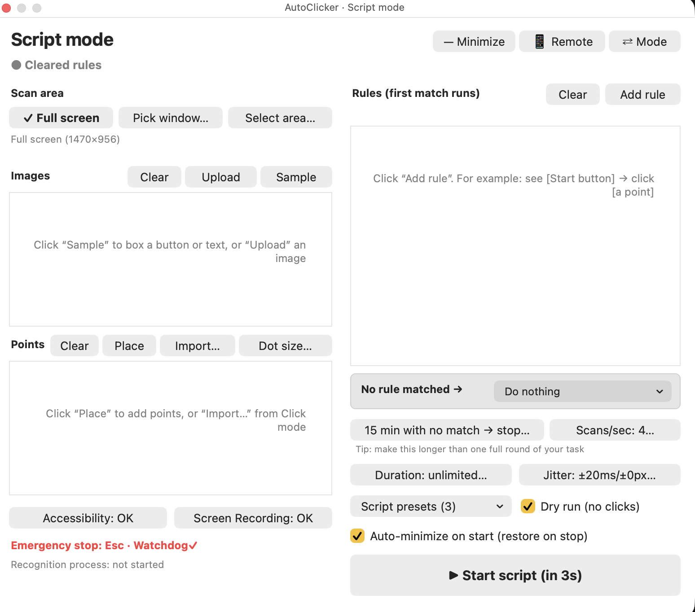
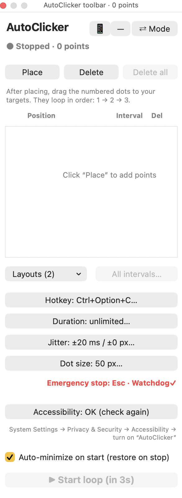

# AutoClicker

[中文](README.md) | English

A macOS auto clicker with a floating toolbar. It runs on JXA (JavaScript for Automation) and AppKit, which are built into macOS, so you don't need Xcode. The app stays out of the Dock and keeps an icon in the menu bar.

It has two modes:

- **Click**: place numbered points and click them in a loop, each with its own interval.
- **Script**: recognize images on screen and act on your rules.

<p>
  
  
</p>

## Disclaimer

This is a general-purpose macOS auto-clicking tool, for learning and personal use.
Many games and websites prohibit automation tools, and using them may lead to account bans or other penalties.
Check the relevant rules before use, and follow your local laws.
You are solely responsible for any consequences of using this tool. The author accepts no liability.

The Jitter option only varies timing and position. It can't bypass any anti-cheat or automation detection.

## Installation

Requires macOS 13 or later. The app is not sold through the App Store or notarized by Apple, so macOS treats a downloaded copy with extra caution.

### Option 1: build from source (recommended)

```bash
git clone https://github.com/ChCharlieC/mac-autoclicker.git
```

```bash
cd mac-autoclicker
```

```bash
./build-app.sh
```

```bash
open "dist/AutoClicker.app"
```

A copy you build yourself normally isn't blocked. If macOS asks you to install the command line developer tools for `git`, follow the prompt. You don't need the full Xcode app.

### Option 2: download the app

1. Download the zip from the Releases page and unzip it.
2. Open the app. macOS will block it the first time.
3. Go to **System Settings → Privacy & Security**, scroll down and click **Open Anyway**, then confirm.

### Permissions

In System Settings the app appears as **AutoClicker**.

- **Accessibility** (required for clicking): System Settings → Privacy & Security → Accessibility, then turn on AutoClicker.
- **Screen Recording** (Script mode only): System Settings → Privacy & Security → Screen & System Audio Recording, then turn on AutoClicker. **Quit and reopen the app** afterwards, because macOS requires it.

### Python packages (Script mode only)

Image recognition needs Python 3 and three packages:

```bash
pip3 install opencv-python numpy mss
```

The app tries the Python.org install, Homebrew and the system `python3`, and uses the first one with these packages. To use another one:

```bash
defaults write com.charlie.autoclicker pythonPath /path/to/python3
```

Click mode doesn't need Python. The phone remote needs `python3` but none of these packages.

## Click mode

1. Choose **Click**, then click **Place** to add a numbered dot and drag it to your target. Add more to get 1, 2, 3…
2. Click a row's `500 ms…` button to set how long to wait after that point (1–60,000 ms).
3. Click **Start loop**. It starts after a 3-second countdown, or immediately with the hotkey `Ctrl+Option+C`.
4. Press the hotkey again, click stop, or press `Esc` to stop.

Other options:

- **All intervals…**: `300` sets all, `50%` is twice as fast, `200%` is half as fast, and `+100` / `-100` adds or subtracts.
- **Layouts**: save and restore a whole set of points and intervals.
- **Hotkey**: choose your own start/stop hotkey.
- **Duration**: stop automatically after a set time, up to 24 hours.
- **Jitter**: vary each click's interval and position at random.
- **Dot size**: 20–100 px. The click position is always the dot's center.

## Script mode

Script mode suits repetitive workflows with a few fixed screens, where each screen needs a specific button.

1. **Scan area**: the full screen, one window (the scan area and points follow it when it moves), or an area you drag out.
2. **Images**: use one of these. Each image has a similarity threshold (default 0.85), and the list shows live similarity while running.
   - **Sample**: drag a box around a button or text on screen.
   - **Upload**: choose a PNG, JPG, BMP, TIFF or WebP file cropped to just the button or text. Any size from 25% to 200% of its on-screen size is matched automatically at run time, then remembered. Blurry images, or ones with different quality or colors, may still not be recognized.
3. **Points**: green dots you can place, drag and rename. **Import…** copies them from Click mode's current points or a saved layout.
4. **Rules**: "If [condition], do [action]", checked from top to bottom. The first match runs.
   - Conditions: **Seen** / **Unseen** [image], joined with **And** / **Or**. **And** comes first: `A And B Or C` means `(A And B) Or C`.
   - Actions: click a point, run a saved Click mode layout, or wait.
   - **Reps**: how many clicks and the interval, or keep clicking until a condition is met (5 minutes at most).
   - **Cool**: time in seconds to wait after the rule acts before checking rules again.
   - Drag **≡** to reorder, and click **Name…** to name a rule.
5. **No rule matched**: do nothing (default), click script points, or loop a Click mode layout.
6. **Stopping**: the script stops after N minutes with no rule matched (default 15), or when Duration runs out. Make N longer than one full round of your workflow.
7. **Scans/sec**: 1–20 per second, default 4. Higher reacts faster but uses more CPU.
8. **Dry run**: recognizes and shows similarity without clicking, for tuning thresholds and rules.
9. **Script presets**: save and load scan area, images, points and rules together.

Use `×` or **Delete** to remove one item. **Clear** removes all images, points or rules after you confirm, and saved presets aren't affected.

Recognition uses grayscale, so two buttons that differ only in color may look the same. Raise the threshold, or sample more of what makes them different.

## Minimize and phone remote

**Minimize** shrinks the toolbar into a small draggable bar. With **Auto-minimize on start** ticked (the default), this happens when you start, and the toolbar comes back when you stop.

**Phone remote** lets your phone view status, start and stop, but not change settings:

1. Click **📱 Remote**, then **Turn on**.
2. Connect your phone and computer to the same Wi‑Fi, then scan the QR code.
3. Bookmark the page. **New password** invalidates old bookmarks and QR codes.

If your Mac asks whether Python may accept incoming connections, click Allow. Some networks block devices from reaching each other. If the page won't load, try home Wi‑Fi or a phone hotspot.

**Security:** the remote uses unencrypted HTTP, and its password is part of the URL. Someone on the same network could intercept it and then start or stop your clicking. **Only use it on Wi‑Fi you trust.** They can't change settings or access your files through it. Turn it off when you don't need it.

## How it works

1. **Clicking**: the app sends mouse clicks through macOS Accessibility, which is why it needs that permission.
2. **Seeing the screen**: Script mode captures the screen at the rate you set and compares it with your images to get a similarity score. This needs Screen Recording permission.
3. **Deciding**: a score that reaches the threshold counts as “seen”. Rules are then checked from top to bottom, and the first match runs.
4. **Remote control**: the phone page sends start and stop commands to a small web service on your Mac, and the app carries them out.
5. **Privacy**: screen captures are processed on your Mac and never uploaded. Only when the phone remote is on can a device on the same network with the URL and password view status, start and stop.

## Language

The app follows your system language the first time. To switch, click **中文** / **English** at the top right of the mode screen or in the menu bar menu. The app restarts by itself and returns to the same mode. You can't switch during a run. The phone page follows the app's language. Logs are always in Chinese.

## Emergency stop

`Esc` stops a countdown or run. It's checked by a global key monitor, the app's own menu, a key-state poll every 30 ms, and again before every click. A separate watchdog process force-quits the app if `Esc` doesn't stop it.

Known limits: clicks already sent can't be undone. While another app uses Secure Keyboard Entry (for example, when a password field has focus), macOS hides key presses, so use the toolbar or menu bar button to stop.

## Data and logs

Nothing is uploaded. Everything stays on your Mac:

- Settings, layouts and scripts: macOS preferences, domain `com.charlie.autoclicker`
- Images and status files: `~/Library/Application Support/com.charlie.autoclicker/`
- Log: `~/Library/Logs/AutoClicker.log`

If Accessibility is turned on but doesn't work, reset it once and allow it again:

```bash
tccutil reset Accessibility com.charlie.autoclicker
```

Implementation notes for developers are in the [Chinese README](README.md).

## License

[MIT](LICENSE) © 2026 ChCharlieC
