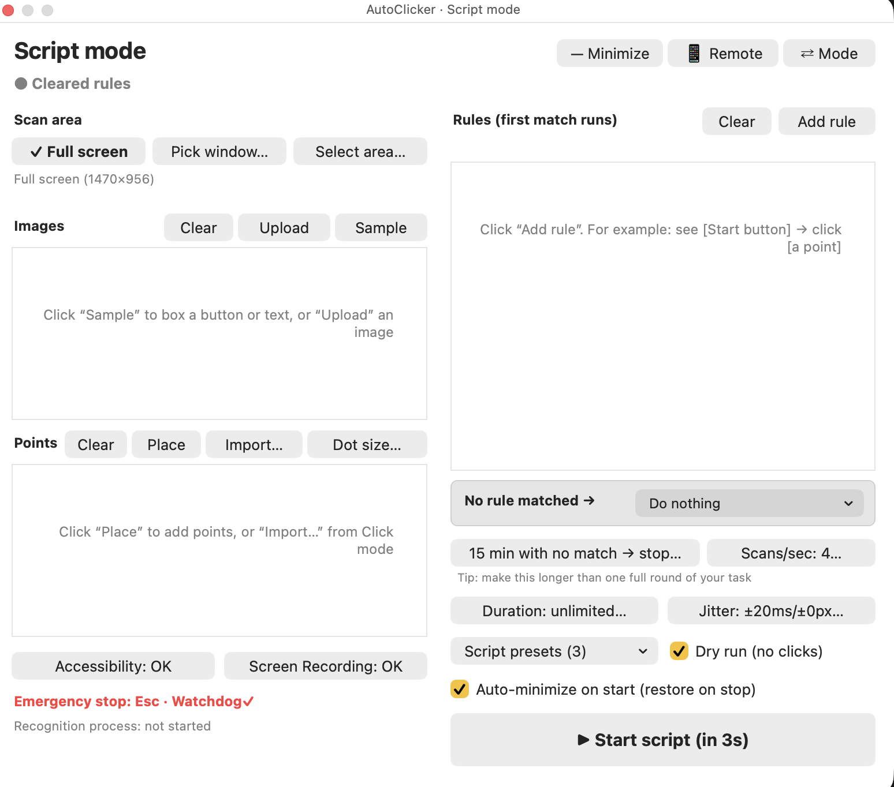
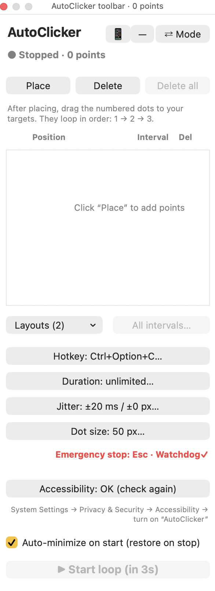

# AutoClicker

中文 | [English](README.en.md)

一个带悬浮工具栏的 macOS 多点连点工具。应用不会显示在 Dock 中，同时会在屏幕右上角保留菜单栏图标。当前可运行版本使用 macOS 自带的 JXA（JavaScript for Automation）+ AppKit 打包，不需要安装 Xcode。

<p>
  
  
</p>

## 免责声明

本工具是通用的 macOS 自动点击工具，仅供学习和个人使用。
许多游戏和网站的规则禁止使用自动化工具，可能导致封号或其他处罚。
使用前请自行查看相关规则，并遵守当地法律。
使用本工具造成的任何后果由使用者自行承担，作者不承担责任。

## 安装

需要 macOS 13 或更新版本。这个 app 没有上架 App Store，也没有经过 Apple 公证，所以 macOS 对下载来的版本会多拦一步。

### 方法一：从源码构建（推荐）

```bash
git clone https://github.com/ChCharlieC/mac-autoclicker.git
```

```bash
cd mac-autoclicker
```

```bash
./build-app.sh
```

```bash
open "dist/AutoClicker.app"
```

自己构建的版本一般不会被拦。如果系统提示安装 `git` 需要的命令行开发者工具，按提示安装就行，不需要完整的 Xcode。

### 方法二：下载打包好的 app

1. 在 Releases 页面下载 zip 并解压。
2. 打开 app，第一次会被 macOS 拦下。
3. 到 **系统设置 → 隐私与安全性**，往下滚动，点 **仍要打开**，再确认。

### 权限

- **辅助功能**（点击必需）：见下文"辅助功能权限"。
- **屏幕录制**（只有脚本模式需要）：见下文"脚本模式 → 准备"。

## 模式

打开程序后先出现**模式选择页**，有两个按钮：

- **点击**：原有的多点序列连点（下面"功能"一节说的都是这个模式）
- **脚本**：识别屏幕上的图片，按规则点击点位或运行点击方案；没对上任何规则时默认什么都不做，也可以设成连点（见下文"脚本模式"）

在两个模式的工具栏里点「⇄ 模式」，或菜单栏图标里的"切换模式…"，可以回到模式选择页（运行中不能切换）。还没选模式时，菜单栏的"显示工具栏"会打开模式选择页，开始/停止快捷键也不会启动任何东西（运行中随时可以用它停止）。

## 功能（点击模式）

- 放置多个可拖动的编号点击点
- 选中反馈：点列表里某一行的编号/坐标处，或在屏幕上点某个圆点，该圆点会冒出金色光环、稍微放大并闪 3 下，列表里对应的行用淡金色背景高亮
- 全部删除：一键删除全部点位，先弹出确认（默认按钮是"取消"，回车不会误删；已保存的方案不受影响）
- 圆点大小：点"圆点大小…"，输入 20–100 像素（默认 52），所有圆点一起变；边输入边在屏幕上预览，"取消"恢复原样，"恢复默认"一键回到 52。改大小不影响点击位置（以圆点中心为准），光环也跟着变
- 按 `1 → 2 → 3 → … → 1` 无限循环点击
- 每个点分别设置"点击间隔"：1–60,000 毫秒（点击该点后等待多久再点下一个）
- 一键调整全部间隔：统一设为某值（`300`）、按比例缩放（`50%` 快一倍 / `200%` 慢一倍，也可写 `x0.5`）、整体加减（`+100` / `-100`）
- 方案：把整套点位（位置 + 间隔）命名保存，之后在"方案"下拉菜单或菜单栏图标里点一下即可恢复布局
- 自定义全局开始/停止快捷键（默认 `Ctrl+Option+C`；勾选修饰键 + 输入主键，实时预览）
- 持续时间：运行指定的小时/分钟/秒后自动停止（留空 = 不限）
- 随机扰动：点击间隔 ±N 毫秒、点击位置 ±N 像素随机浮动（0 = 关闭）
- 固定使用键盘 `Esc` 作为紧急停止键（见下文"停止机制"）
- "删除 / 退出删除"状态和每行独立删除按钮
- 自动保存点位、顺序、间隔、快捷键、持续时间、扰动设置和圆点大小
- 运行时隐藏编号圆点，避免圆点挡住真实点击目标

## 脚本模式

适合有固定流程的重复操作：几个固定页面（开始、结果、确认……）需要点特定按钮，其余时间可以等待或一直连点。

### 准备（只需要一次）

1. 安装 Python 3 和下面这些依赖（点击模式不需要；手机遥控只需要 `python3`，不需要这些库）：
   ```bash
   pip3 install opencv-python numpy mss
   ```
   程序会依次尝试 Python.org 安装版、Homebrew 和系统自带的 `python3`，用第一个装好了这些库的。装在别处可以指定：`defaults write com.charlie.autoclicker pythonPath /路径/python3`
2. 授权"屏幕录制"：第一次取样或开始时会提示。系统设置 → 隐私与安全性 → 屏幕与系统录音 → 打开"AutoClicker"，**然后退出并重新打开 AutoClicker**（macOS 要求重开才生效）。工具栏左下角显示"屏幕录制：已授权"即可。
3. "辅助功能"权限和点击模式共用（演练模式不需要）。

### 界面（左栏：范围、图片、点位；右栏：规则、设置、开始）

1. **扫描范围**（三个按钮，当前选中的前面有 ✓）：
   - 整个屏幕：所有显示器合起来
   - 选一个窗口：弹出当前所有窗口的列表（例如某个 app 的窗口）。窗口移动后扫描范围和点位都会跟着走（每秒检查一次位置）。窗口最小化或被关掉时暂停连点，但照样计入下面的"N 分钟"计时
   - 框选区域：在屏幕上拖一个框
2. **图片**：点「取样」→ 在屏幕上拖框框住一个按钮或一段文字 → 起名字。图片保存在 `~/Library/Application Support/com.charlie.autoclicker/images/`。每张图有"相似度门槛"（默认 0.85，可改为 0.50–0.99）：相似度达到门槛才算"看到"。列表右侧在运行时实时显示当前相似度（绿色 ✓ = 看到了）。
   - 也可以点「上传」选一张图片（PNG、JPG、BMP、TIFF、WebP），不用打开目标画面，也不用管大小。图片要裁剪到只剩按钮或文字本身。运行时程序会自己轮流试不同的大小（25%–200%），同一个大小连续 3 帧达到门槛才记住，之后就和取样的图片一样快，下次打开也不用再找。列表里显示“找大小…”表示第一轮还没试完，这时依赖这张图的“看到”和“没看到”条件都先不成立。这个办法只解决大小不同；画质或颜色不一样时还是可能认不出。
3. **点位**：绿色圆点（点击模式的是蓝色），可放置、拖动、改名、设间隔；列表从上往下就是顺序。「导入…」弹出菜单：可以导入点击模式**现在**的点位，或点击模式里**保存过的某个方案**（导入的点位名字带方案名）。「圆点大小…」和点击模式里的同一个设置，两个模式的圆点一起变。扫描范围是窗口时，点位存成"相对窗口左上角"的位置。
4. **规则**：每条规则是"如果 条件 → 就 动作"，带冷却时间。
   - 条件：`看到` / `没看到` [图片]；用「+ 条件」加更多条件，用「并且」「或者」串成一行。不做括号嵌套，"并且"优先：`A 并且 B 或者 C` = `(A 并且 B) 或者 C`
   - 动作：点击[点位] / 运行点击方案 / 等待[秒]
   - 运行点击方案：下拉菜单里只列**点击模式**保存的方案。选中时把方案的全部数据（每个点的位置、顺序、各自的间隔）复制进规则，所以不用把这些点加到脚本模式的点位里；开始运行时如果点击模式里同名方案还在，会自动换成它最新的数据，被删了就继续用复制的那份。一轮 = 按顺序把所有点按各自间隔点一遍；「次数」变成「运行几轮」或「一直运行，直到…」。随机扰动和点击模式是同一个设置，只加一次。选方案时会记下扫描窗口的位置，窗口挪了整套点击会跟着平移
   - 次数（只有点击动作有）：点「点 1 次…」按钮，自己填点几次（1–9999）和每次间隔多少毫秒；或勾选「一直点」，规则卡片会多出一行「直到 [看到 / 没看到][图片]」，例如"直到看到[结果页]"就停。连续点击期间不检查别的规则、也不默认连点；点完（或"直到"的条件满足）才开始冷却。"一直点"最多连续 5 分钟，Esc 随时可停；窗口找不到时也会立刻停下
   - 冷却（单位是秒，和扫描次数、点击次数无关）：规则执行后，在冷却时间内不触发任何规则、也不连点；过了冷却再继续判断（如果页面还在，就会再执行一次）
   - 调顺序：按住规则左上角的「≡」上下拖动，蓝线是落点，松开就移过去（可以直接拖到第一）；也可以用「↑」「↓」一次移一位。移动后那条规则的边框会闪一下绿色。「删除」删除整条规则
   - 命名：点「起名字…」给规则起名，例如"开始""结果"。序号（规则 1、规则 2…）始终显示，名字跟在后面，日志和状态栏里也会显示
5. **默认规则**（固定在规则表下面）：以上都没对上 → 「什么都不做」（默认）/ 连点脚本点位（全部或勾选几个）/ 循环运行一个点击模式的方案。选"什么都不做"时，只有规则成立才会点击。
6. **停止条件**：
   - 连续 N 分钟（默认 15）没有对上任何一条规则 → 停止，状态栏显示"已停止：N 分钟没有识别到任何页面"。**N 要比一轮完整流程的时长更长**
   - 持续时间（和点击模式共用）到了就停止
   - Esc 四层停止和看门狗全部有效
7. **演练（只识别不点击）**：勾选后开始，只截图识别、显示相似度和"当前会执行哪条规则"，不点击（日志里记为"演练点击"），用来调门槛和规则。
   图片和点位每行右边的 ×、规则卡片上的「删除」用来删单个；图片、点位、规则各有一个「清空」按钮，确认后一键全删（已保存的脚本方案不受影响）。
8. **脚本方案**：「脚本方案」下拉菜单里保存 / 载入 / 删除，一起保存范围、图片、点位、规则、默认连点和 N 分钟设置，和点击模式的方案分开存（最多 20 个）。

### 运行逻辑

- "眼睛"是独立的 Python 进程（`Contents/Resources/eye.py`），按「每秒扫描 N 次」的设置截图识别（1–20 次，默认 4 次，跟脚本一起保存），把结果写进 `eye-result.json`；主程序按同样的频率读一次。眼睛崩溃会自动重启（至少隔 2 秒）；超过 1.5 秒拿不到新结果就当作"没对上任何规则"。刚开始时最多等 5 秒第一帧结果，期间不连点。
- 每次扫描从上往下检查规则，执行**第一条**条件成立的规则。
- "手"只有一个：规则一成立就立刻停住默认连点，执行动作，等冷却过完才可能恢复连点，规则动作和连点绝不会同时发出点击。
- 识别在"点"的分辨率上做（Retina 截图会缩放回点），所以取样图片、识别位置和点击坐标始终是同一个尺度，不用自己换算。
- 识别用灰度图，只靠颜色区分的两个按钮（例如亮色/灰色的同一个按钮）可能分不清，这时请把门槛调高，或取样时多框一点有区别的内容。
- 开始前会检查：规则是否都选好了图片/点位、窗口是否找得到、工具栏是否挡住扫描范围或点位、屏幕录制权限、Python 依赖。

## 最小化和手机遥控（两个模式都有）

### 最小化
- 工具栏右上角「—」（脚本模式是「— 最小化」）：工具栏收成一条小条，按住小条空白处可以拖动，位置会记住。小条上显示状态（脚本模式显示正在执行哪条规则）、▶/■ 开始停止、⤢ 展开。菜单栏图标里也有「最小化工具栏」，「显示工具栏」可以展开。
- 「开始后自动最小化（停止后自动展开）」勾选框：默认勾上。勾上时按开始就自动收起，停止后自动展开（不抢前台窗口的焦点）。
- 开始前的"被挡住"检查：会自动最小化时检查的是小条的位置，否则检查工具栏。
- 快捷键 Control + Option + C 在两个模式、最小化时都能开始 / 停止；Esc 照常紧急停止。

### 手机遥控
- 工具栏的「📱」（脚本模式是「📱 手机遥控」）或菜单栏「手机遥控…」打开面板，点「打开遥控」后显示二维码。手机和电脑连同一个 Wi‑Fi，用相机扫码打开网页，建议存成书签。
- 网页上能看：模式、运行状态、剩余时间（设了持续时间才有）；脚本模式还有当前规则、每张图片的相似度、离"N 分钟停止"还剩多久。能做：开始（和工具栏一样先检查，再 3 秒倒计时）、停止。不能改设置。开始前检查没通过时，原因会显示在手机上。
- 网址形如 `http://电脑名.local:8765/?key=密码`：用的是电脑名，换 Wi‑Fi 也不用重新扫码；密码一直不变，点「换密码」后旧书签失效。面板里还有一个 IP 网址备用。
- **安全提醒：只在你信任的 Wi‑Fi 下使用。** 网页走的是不加密的 HTTP，密码就在网址里，同一个网络里的人有可能截获，然后开始或停止你的连点。他们不能通过它改设置或读取文件。不用时建议关闭。
- 部分网络禁止设备之间互相访问，网页打不开时可以换家里的 Wi‑Fi 或手机热点。
- 只在局域网内有效，没有密码一律拒绝。遥控开着时退出 AutoClicker，下次启动会自动重新打开。第一次打开时 Mac 可能问"是否允许 Python 接受传入连接"，点允许。
- 实现：`remote.py`（只用 Python 自带的库）开网页服务，和主程序通过 `remote-status.json` / `remote-command.json` 传消息；网页服务意外退出会自动重启。

## 工作原理

1. **点击**：程序通过 macOS 的辅助功能权限发送鼠标点击，所以需要授权。
2. **看屏幕**：脚本模式按设定的频率截屏，把画面和你的图片做对比，算出相似度。这需要屏幕录制权限。
3. **判断**：相似度达到门槛就算“看到”，然后从上往下检查规则，执行第一条成立的。
4. **遥控**：手机网页把开始或停止的命令发给电脑上的小型网页服务，再由 app 执行。
5. **隐私**：截图只在本机处理，不会上传。只有打开手机遥控时，同一网络里有网址和密码的设备才能查看状态、开始和停止。

## 语言（中文 / English）

- 第一次打开时跟随系统语言。之后在模式选择页右上角，或菜单栏图标的菜单里，点「English」/「中文」切换。
- 界面文字在创建窗口时就定下了，所以切换时会自动重启应用，并回到原来的模式。所有设置都是改动时就保存的，不会丢。运行中不能切换。
- 手机网页跟随应用的语言。日志（log）一直是中文。
- 代码里用 `tr("中文")` 输出界面文字，对照表在 `Sources/I18n.js`。新增界面文字时要同时加进对照表；没有汉字的片段（括号、引号）不用加，英文下会自动换成半角。
- 英文下对话框会按字数自动加高。按钮、标签的宽度是固定的，英文要写得够短。

## 构建和运行

在项目文件夹里运行：

```bash
./build-app.sh
```

```bash
open "dist/AutoClicker.app"
```

构建后的应用位于项目里的 `dist/AutoClicker.app`。`dist/` 和 `backup/` 都不进 git。

## 辅助功能权限

macOS 只有在获得"辅助功能"权限后才允许应用生成鼠标点击。

- 第一次启动未授权时，应用会让系统弹出授权提示，并显示自己的权限窗口；到"系统设置 → 隐私与安全性 → 辅助功能"打开"AutoClicker"开关，再点窗口里的"重新检查"（应用每 1.5 秒也会自动重查）。
- 构建脚本用显式的 `designated => identifier "com.charlie.autoclicker"` 签名要求做 ad-hoc 签名。默认的 ad-hoc 签名要求只含 cdhash，每次重新构建都会变，导致旧授权条目不再匹配（开关是开的但不生效）——这是之前反复要重新授权的原因。改用 identifier 匹配后，重新构建不需要重新授权。
- 如果列表里已有旧的"AutoClicker"条目但仍不生效（旧 cdhash 条目），执行一次 `tccutil reset Accessibility com.charlie.autoclicker`，重新打开应用按提示授权即可。这只需要做一次。

## 使用方法

1. 在模式选择页点"点击"，打开工具栏。点击工具栏的"放置"，生成一个带编号的圆形标记，拖到需要点击的位置；继续添加得到 `1、2、3…`。
2. 点击点位列表中的 `500 ms…` 按钮，在弹出的窗口里输入新的间隔，回车保存、Esc 取消。非法输入会在窗口内红字提示，不会关闭窗口。间隔和快捷键输入框固定使用英文输入源（即使当前是中文输入法），回车直接保存，不会被输入法吃掉。
3. "开始/停止快捷键"：勾选 Ctrl / Option / Shift / Cmd 中至少一个，再输入主键（字母、数字、F1–F12、Enter、Space、Tab、Up/Down/Left/Right），窗口里会实时显示"将设为：…"，无法识别的主键会直接提示。
4. "持续时间"：输入小时、分钟、秒，运行到时自动停止；运行中状态栏显示剩余时间。全部留空或 0 表示一直运行到手动停止，最长 24 小时。
5. "随机扰动"：间隔浮动（0–10000 ms）和位置偏移（0–50 px），每次点击在设定值附近随机取值，让节奏和落点不那么机械。它不能绕过任何反作弊或自动化检测，请只在允许使用自动点击的场景用。
6. 点击"开始循环"，倒计时 3 秒后开始；用快捷键 `Ctrl+Option+C` 则立即开始。
7. 再按一次快捷键、点击停止按钮，或按 `Esc` 停止。

**方案（一键布局）**：摆好点位、调好间隔后，点工具栏的"方案" → "把当前点位保存为方案…"，起个名字保存（同名会覆盖）。下次点"方案" → "载入：xxx"，当前点位会被整套替换。菜单栏图标里的"载入方案"效果相同。删除在"方案" → "删除方案"里，最多保存 20 个。

**全部间隔**：点"全部间隔…"，输入 `300`（全部设为 300 ms）、`50%`（全部减半，变快）、`200%`（全部加倍，变慢）或 `+100` / `-100`（整体加减），窗口里会实时预览改动结果，结果自动限制在 1–60,000 ms。

点击"删除"后圆点变红，点击圆点即可删除；"退出删除"恢复。列表右侧的 `×` 也可以直接删除。运行期间不能增删、拖动或修改间隔。工具栏关闭后可从菜单栏图标重新显示。

## 停止机制（Esc）

`Esc` 只在倒计时或运行中生效，只负责停止。有四层检测，任何一层触发都会停止：

1. **全局键盘监听**（其他应用在前台时；依赖辅助功能权限）
2. **隐藏主菜单的 key equivalent**（本应用自己在前台时）
3. **每 30 毫秒轮询 Esc 物理按键状态**（与前台应用无关）
4. **每次发送点击之前同步检查 Esc 是否已按下**——预先按住 Esc 再启动不会发出第一下点击

发出的鼠标事件会清空修饰键标志：用 `Ctrl+Option+C` 启动时手指还按着 Ctrl/Option，否则第一下会变成 Ctrl-点击（右键菜单）。

另外还有一个**独立看门狗进程**（`Contents/Resources/watchdog.js`，由主程序用 `osascript` 启动，不依赖主程序的事件循环）：

- 主程序处于倒计时/运行中时按住 Esc ≥ 0.5 秒仍未停止 → 强制退出主程序
- 按下 Esc 后 0.6 秒主程序仍在同一轮运行 → 强制退出主程序
- 主程序心跳超过 3 秒未更新（主线程无响应）且按住 Esc ≥ 1.5 秒 → 强制退出主程序

工具栏底部"看门狗✓ / ✗"显示看门狗是否在运行；被看门狗强制退出后，下次启动会在状态栏显示原因。

已知限制：已经发出去的点击无法撤回；当其他应用开启了"安全键盘输入"（例如密码框获得焦点）时，系统会屏蔽全局键盘监听和按键状态读取，此时只能用工具栏/菜单栏按钮停止。

## 诊断

- 日志：`~/Library/Logs/AutoClicker.log`（菜单栏"打开日志文件"可直接打开）。记录启动、权限状态、对话框开关、间隔保存、开始/停止、Esc 触发来源等，不记录普通按键内容。
- 看门狗日志：`~/Library/Application Support/com.charlie.autoclicker/watchdog.log`
- 方案保存在 `defaults read com.charlie.autoclicker layoutsJSON`；脚本模式当前脚本在 `scriptJSON`，脚本方案在 `scriptLayoutsJSON`
- 眼睛进程：配置 `eye-config.json`、结果 `eye-result.json`、错误输出 `eye-stderr.log`（都在 `~/Library/Application Support/com.charlie.autoclicker/`）。也可以单独测试：`python3 Sources/eye.py check`
- 状态文件：`~/Library/Application Support/com.charlie.autoclicker/state.json`
- 演练模式（不发送真实点击，只在日志里记录"演练点击"，且不需要辅助功能权限；脚本模式也可以直接勾选工具栏上的"演练"）：
  `defaults write com.charlie.autoclicker dryRun -bool true`；关闭：`defaults delete com.charlie.autoclicker dryRun`
- 模拟主线程卡死 N 秒（只用于测试看门狗）：`defaults write com.charlie.autoclicker debugSimulateHangSeconds -int 8`；测完务必 `defaults delete com.charlie.autoclicker debugSimulateHangSeconds`

## 实现说明（JXA 相关的坑）

- 列表重画时换掉的旧视图里，如果有按钮设过鼠标悬停提示（toolTip），旧视图被 JXA 回收后，系统的提示管理器下次窗口获得焦点时还会去访问它们，导致闪退（崩在 `NSToolTipManager windowDidBecomeKeyNotification:`）。换列表一律走 `replaceListDocument`：先递归 `removeAllToolTips`，再把旧视图留一阵子（最多 50 份）。

- 下拉菜单（NSPopUpButton）里自己 `addItem` 进去的菜单项，如果 action 为空，选中后下拉按钮**不会**发出动作：界面上看着选上了，数据却没变，下次重画就"变回去"。每个菜单项都要单独设 target/action（命令放 identifier、序号放 tag）。

- 不能用 `NSEvent.addLocalMonitorForEventsMatchingMask:handler:`：JXA 无法正确桥接这个 block 的返回值，AppKit 会收到 `JSValue` 并抛 `unrecognized selector`，结果是应用处于活动状态时所有按键都被丢弃——这就是之前"点击间隔改不了"和"卡死"的根因。
- 不使用 `NSAlert.runModal`：所有对话框都是非模态的 `NSPanel`，避免在 JXA 回调里进入嵌套事件循环。
- 选文件用 `NSOpenPanel.beginWithCompletionHandler:`（不用 `runModal`）。回调函数要存到对象上留住引用，真正的处理放到 `scheduleOnce` 里，不在面板回调中同步弹窗。
- 光环、选中行高亮用 `NSBox`（`boxType = NSBoxCustom`）的边框和填充色实现，不用 CALayer 的 `CGColor`，也不在 JXA 里重写 `drawRect:`，避免 CoreGraphics 类型桥接问题。
- 列表行的"点击选中"用一个透明 `NSButton`（`transparent = true`）盖在编号和坐标上，不重写 `hitTest:`（JXA 子类方法不方便接收 `NSPoint` 结构体参数）。
- 圆点拖动按"鼠标相对圆点中心"的偏移计算，因为闪烁时圆点窗口会临时变大；保存坐标也取窗口中心。
- 给 ObjC 方法传 nil 要用 `$()`；JS 的 `null` 会变成 `NSNull` 对象，传给 `NSDictionary *`、`NSError **` 之类的参数会崩溃。
- 源码分成 `Sources/I18n.js`（语言和中英对照表）、`Sources/AutoClicker.js`（主程序、点击模式）、`Sources/ScriptMode.js`（脚本模式）和 `Sources/Remote.js`（最小化、手机遥控）。`build-app.sh` 先把它们按顺序拼起来再交给 `osacompile`。
- 主程序和 Python 眼睛之间用文件通信，不用 stdout 管道：`NSFileHandle` 的 `readabilityHandler` 在后台线程回调 JS block，JXA 里不安全。
- 需要等待子进程结束时（检查依赖、取样截图）用"轮询 `running` + `NSThread.sleepForTimeInterval`"，不用 `waitUntilExit`——后者会运行 run loop，让定时器在等待中途重入执行。
- `CGPreflightScreenCaptureAccess` / `CGRequestScreenCaptureAccess` 没有被 JXA 自动桥接，用 `ObjC.bindFunction` 手动绑定。
- 运行中跟踪窗口位置用 `CGWindowListCopyWindowInfo(kCGWindowListOptionIncludingWindow, 窗口编号)` 只查一个窗口，每秒一次，避免反复复制整个窗口列表。
- 脚本工具栏的按钮和下拉菜单共用一个 action（`scriptCommand:`），具体命令写在控件的 `identifier` 里（例如 `rule.up:3`），不用为每个按钮注册一个 selector。
- `NSPopUpButton.addItemsWithTitles` 会合并同名项，下拉菜单一律逐项 `menu.addItem`（图片可能重名）。

## 许可证

[MIT](LICENSE) © 2026 ChCharlieC
